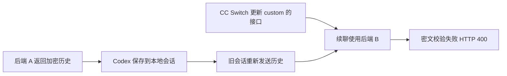

# 换后端后 invalid_encrypted_content 的问题分析

## 结论与证据边界

这类 HTTP 400 通常发生在**服务端校验旧历史的不透明加密内容**时。更换配置改变了续聊请求的接收后端；失败并不意味着 TOML 本身无法解析。

本次脱敏案例中，从 `https://api666.zzzcoding.org/v1` 切换到 `https://anyrouter.top/v1` 后，同目录旧会话失败，新会话可以运行。旧会话错误事件中的 request id 与用户提供的错误一致，含 127 条加密推理和 5 条加密代理片段，且两端配置都使用 `custom` 标识。旧会话创建版本为 0.162.1，当前 CLI 为 0.169.0，历史模式为 `paginated`。

这些证据高度支持“历史密文跨后端回放不兼容”。错误信息没有指出具体 offending item，因此不能断言 132 个字段全部无效，也无法仅凭公开信息确定下游密钥、账号或版本变化的精确边界。工具主动移除所选历史中的可识别密文，不尝试猜测哪些还能跨后端使用。

## 机制

1. Responses 可以在无服务器存储的模式下返回加密推理内容，供后续请求携带。
2. Codex 将返回的 `ResponseItem` 持久化，包括 `encrypted_content`。加密代理消息也可能作为内容片段存储。
3. 续聊回读历史，压缩检查点的 `replacement_history` 也会进入模型回放。
4. 新服务端不能接受某个旧密文时，以 `invalid_encrypted_content` 拒绝整个请求，通常尚未开始模型采样。
5. 向这个旧会话再次发送“继续”，仍会携带相同旧密文，所以单纯重试通常不会恢复。

`base_url` 是可观察到的变化；真正的兼容边界在下游服务。不同 URL 可能共享后端，同一 URL 也可能动态路由至不同后端。API Key 轮换是否造成问题取决于实际服务实现，不应一概推断。

## 官方源码依据（固定版本）

以下来源以 `rust-v0.169.0` 固定版本引用，避免主分支变化：

- [请求构造：client.rs L1231–L1260](https://github.com/openai/codex/blob/rust-v0.169.0/codex-rs/core/src/client.rs#L1231)：非 OpenAI 提供商会清理部分可选字段，但明确保留 `Reasoning`、`Compaction` 和 `ContextCompaction` 的加密内容；仍包含 `reasoning.encrypted_content` 请求项。
- [响应模型：models.rs L1128–L1147](https://github.com/openai/codex/blob/rust-v0.169.0/codex-rs/protocol/src/models.rs#L1128)：代理消息有结构化内容，推理记录存储加密字段。
- [代理内容：models.rs L976](https://github.com/openai/codex/blob/rust-v0.169.0/codex-rs/protocol/src/models.rs#L976)：区分 `InputText` 与 `EncryptedContent`。
- [历史前缀的字节位置：protocol.rs L3463](https://github.com/openai/codex/blob/rust-v0.169.0/codex-rs/protocol/src/protocol.rs#L3463)：包含 `end_ordinal_exclusive` 与 `end_byte_offset`。
- [压缩数组反序列化：rollout_payload.rs L401](https://github.com/openai/codex/blob/rust-v0.169.0/codex-rs/history/src/rollout_payload.rs#L401)：`replacement_history` 与其元数据长度必须相同。
- [原生写入锁：writer_lock.rs L45](https://github.com/openai/codex/blob/rust-v0.169.0/codex-rs/rollout/src/writer_lock.rs#L45)：会话锁位于 `thread-writer-locks`，有目录协调锁及操作系统文件锁。
- [无存储的推理回放文档](https://developers.openai.com/api/docs/guides/reasoning#preserve-reasoning-without-stored-responses)：解释加密推理在 stateless 请求中的用途。

社区报告提供了相似复现，但不是服务商内部实现的证明：

- [openai/codex #53713](https://github.com/openai/codex/issues/53713)：切换 `model_provider` 后原会话出现相同错误，指出历史推理密文仍被回放。
- [openai/codex #36704](https://github.com/openai/codex/issues/36704)：压缩与推理密文可能掩盖另一类协议错误。该报告中的删除旧工具调用方法不作为本工具的通用修复策略。

## 可重复的诊断步骤

1. 明确目标会话 UUID、工作目录和当前 rollout 路径，避免把同目录的正常新会话误当成旧会话。存在 revert 产生的多个文件时，优先采用只读状态数据库当前指向的路径。
2. `inspect` 检查历史错误事件、密文字段位置、当前配置白名单、版本和历史模式。不要把聊天中引用的错误字符串当成真实错误事件。
3. 对比新会话是否正常。没有历史的新会话也失败时，优先排查当前服务兼容性，而不是清理所有会话。
4. `repair` 生成不写入的计划：所有修改必须通过语法、元数据、每行字节预算、剩余密文字段等检查。
5. 停止并卸载目标会话，取得原生写入锁，再使用 `--apply --offline`。文件已变化时重新预览，不能盲目重试覆盖。
6. 重新打开原会话，以一次短而明确的续聊检查真实后端是否接受。原错误日志保留用于追溯。
7. 遇到未知格式、不可读的压缩摘要或外部历史前缀，选择明文交接方案；修复后新增消息时不覆盖回滚。

## 数据保护与局限

工具不会解密服务端密文。公开推理摘要与隐藏推理不等价；只存在于加密代理片段或加密压缩里的信息，无法在不知道原服务实现和解密材料时恢复。

分页索引不仅引用记录序号，还引用文件的字节位置。修复将加密推理响应改为合法本地事件，用尾随空格保持原行长度。历史记录数量、所有后续起点、CRLF/LF 和 BOM 均不变；普通消息和工具 I/O 的原始字节不变。

这比删除行更便于保全已知索引，但仍要求目标会话完全停止，防止内存中的旧历史被再次写回。客户端更新出新的加密字段、存储摘要或引用格式时，应先扩充测试再宣称兼容。

本仓库的本地模拟测试证明“不兼容签发方 → 400 → 移除不透明历史 → 200”的因果链与客户端回放路径。模拟采用 HMAC，不推断 OpenAI 实际使用的加密算法。生产接口验证必须区分本地测试与真实网关续聊结果。
